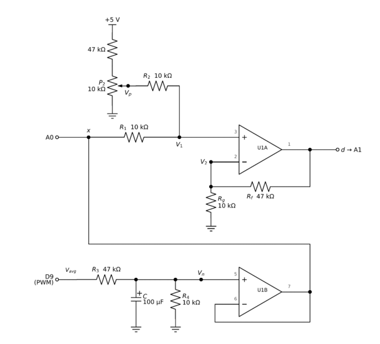
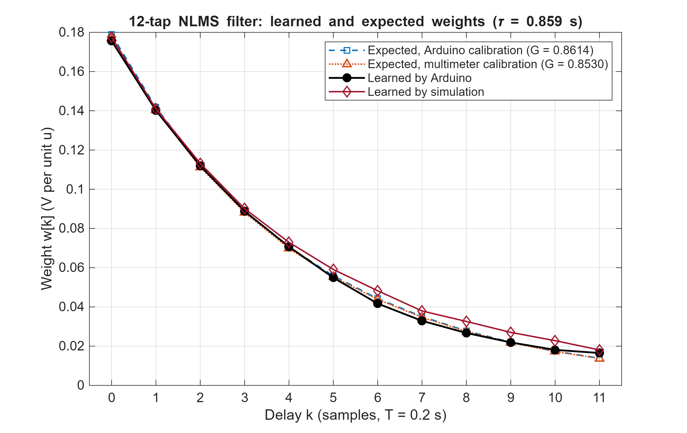
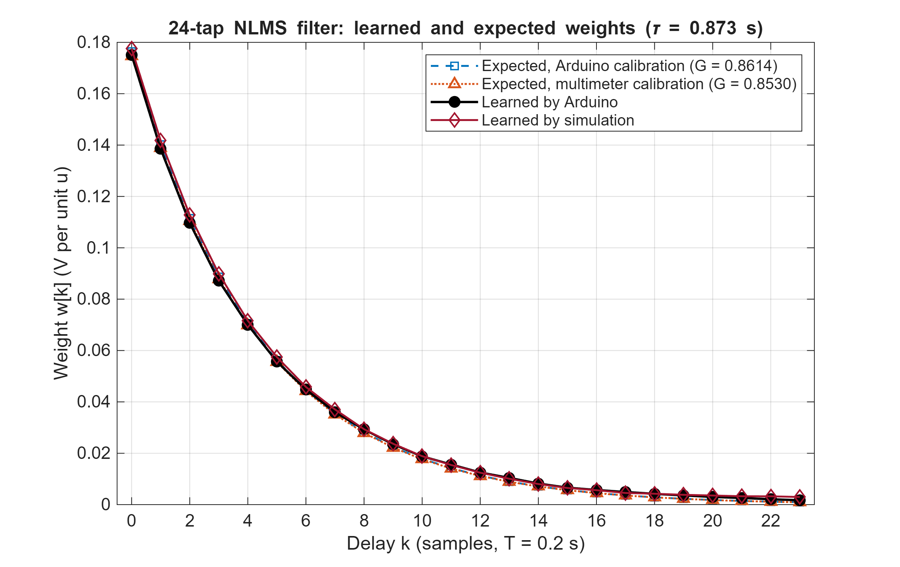

# Adaptive System Identification of an RC Analog Plant using NLMS on an Arduino

An Arduino Uno identifies the impulse response of a breadboard RC circuit with a
normalized least-mean-squares (NLMS) adaptive FIR filter, trained online from random
PWM inputs. Filters with 12 and 24 taps are compared, and the whole experiment is
replicated in a MATLAB model that includes the PWM switching, the 10-bit ADC and the
same learning and stopping rules.

**Main result:** with 24 taps the learned weights follow the expected RC response
to within 1.2 mV RMS, and the trained filter predicts unseen outputs with 2.4 mV RMS
error, compared with 13.5 mV for 12 taps.



## Repository structure

```
.
├── docs/
│   ├── report/          Project report (IEEE conference format, Word and PDF)
│   └── presentation/    Project presentation (PowerPoint)
├── hardware/
│   ├── circuit_diagram.png
│   ├── hardware_setup.jpeg
│   └── BOM.md           Components, specifications and quantities
├── firmware/
│   └── lms_simple/
│       └── lms_simple.ino   Arduino sketch: training, early stopping and test
├── simulation/
│   ├── nlms_rc_sim.m    MATLAB model of the full experiment
│   └── nlms_rc_plots.m  Weight plots (expected, breadboard, simulation)
└── results/
    ├── summary.csv                  Breadboard vs simulation, 12 and 24 taps
    ├── hardware/
    │   ├── dc_calibration.csv
    │   ├── weights_12tap.csv
    │   └── weights_24tap.csv
    ├── simulation/
    │   ├── weights_12tap.csv
    │   ├── weights_24tap.csv
    │   ├── nlms_sim_results.mat     Saved MATLAB results (seed 1)
    │   └── console/                 MATLAB console output
    └── plots/
        ├── weights_12tap.png
        └── weights_24tap.png
```

## How it works

1. **Plant.** Arduino pin D9 outputs PWM (≈490 Hz). R3 = 47 kΩ, R4 = 10 kΩ and
   C = 100 µF smooth it into a first-order lag with time constant τ = (R3‖R4)·C.
   An LM358 buffer (U1B) copies the capacitor voltage, and a summing amplifier (U1A)
   produces d = 2.85(x + Vp), read by the Arduino on A1.
2. **Model.** The duty D is scaled to u[n] = (D − 120)/80. Sampled every T = 0.2 s,
   the plant's impulse response is h[k] = G(1 − a)aᵏ with a = e^(−T/τ).
3. **Filter.** ŷ[n] = b + Σ w[k]·u[n−k], k = 0 … M−1, with error e[n] = d[n] − ŷ[n].
4. **NLMS update.** g = μ·e[n] / (ε + 1 + Σu²); b ← b + g; w[k] ← w[k] + g·u[n−k],
   with μ = 0.2 and ε = 0.001.
5. **Training.** Random duty 40–200 every 0.2 s. The RMS error is computed over
   100-step windows; training stops after 3 consecutive windows below the threshold
   (20 mV for 12 taps, 15 mV for 24 taps), or after 1000 steps.
6. **Test.** 200 new random steps with the weights frozen.

## Running the firmware

1. Build the circuit in `hardware/` (components in `hardware/BOM.md`).
2. Open `firmware/lms_simple/lms_simple.ino` in the Arduino IDE.
3. Set the constants at the top of the sketch:
   - `VREF`: your measured 5 V rail voltage (5.14 V here).
   - `M`: 12 or 24 taps.
   - `RMS_STOP` is set automatically from `M`: 0.020 V (20 mV) for 12 taps and 0.015 V (15 mV) for 24 taps, as used in the experiment.
4. Upload and open the Serial Monitor at 115200 baud. Commands:

| Command | Action |
|---|---|
| `a` / `b` / `c` | Hold duty 40 / 120 / 200 (DC calibration) |
| `m` | Read the output d once |
| `g` | Train (prints d, y, e and window RMS every 100 steps, then the weights) |
| `t` | Test with frozen weights (RMS and maximum error) |

Opening the Serial Monitor resets the Arduino and clears the learned weights, so run
`g` and `t` in the same session.

## Running the simulation

From the `simulation/` folder in MATLAB (R2016b or later, no toolboxes):

```matlab
nlms_rc_sim      % calibration, training, test and tables for 12 and 24 taps
nlms_rc_plots    % weights_12tap.png and weights_24tap.png
```

`nlms_rc_sim.m` saves `nlms_sim_results.mat`, which `nlms_rc_plots.m` loads if present.
The plant is configured from the measured gain (G = 0.8614), time constant
(τ = 0.873 s) and output at duty 120; the ADC noise (0.7 LSB) is an assumed value.
The stopping thresholds match the hardware: 20 mV for 12 taps and 15 mV for 24 taps.

## Results

| Quantity | Breadboard, 12 taps | Breadboard, 24 taps | Simulation, 12 taps | Simulation, 24 taps |
|---|---|---|---|---|
| Training steps (early stop) | 600 | 600 | 600 | 600 |
| Stopping threshold (mV) | 20 | 15 | 20 | 15 |
| τ estimate (s) | 0.859 | 0.873 | 0.909 | 0.886 |
| Weight RMS vs expected (mV) | 1.7 | 1.2 | 3.7 | 1.5 |
| Tail-only error (mV) | 10.4 | 0.7 | 10.7 | 0.7 |
| **Test RMS error (mV)** | **13.5** | **2.4** | **12.9** | **4.4** |
| Test max error (mV) | 35.9 | 9.9 | 35.1 | 11.9 |

Expected weights use the Arduino-calibrated gain and each run's own τ estimate.
Full tables are in `results/`.

| 12 taps | 24 taps |
|---|---|
|  |  |

With 12 taps about 6% of the RC response lies beyond the filter's memory, which
accounts for most of the 13.5 mV error; 24 taps capture all but 0.4%, leaving ADC
noise as the floor.

## Limitations

- Expected weights use τ estimated from the same run, so they test gain and shape, not τ itself.
- The simulation is configured from measured G and τ with an assumed ADC noise level.
- Each tap count was trained once.
- The Arduino ADC and the multimeter differ by 1.0%; neither was checked against a reference.
- An FIR filter only approximates the infinite RC response; a two-parameter IIR model would match it exactly.

## Documentation

- Report: [`docs/report/NLMS_RC_identification_report.pdf`](docs/report/NLMS_RC_identification_report.pdf) (editable version: `NLMS_RC_identification_report.docx`)
- Presentation: [`docs/presentation/NLMS_RC_identification_presentation.pptx`](docs/presentation/NLMS_RC_identification_presentation.pptx)

## Author

Mahesh Mishra, School of Electronics Sciences, Odisha University of Technology and Research, Bhubaneswar.
